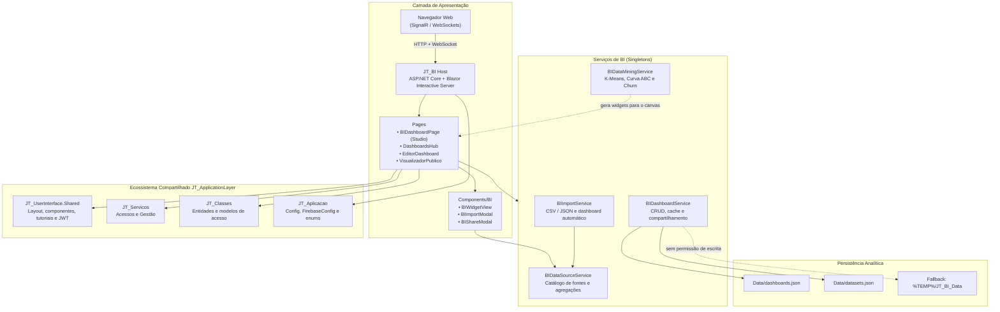
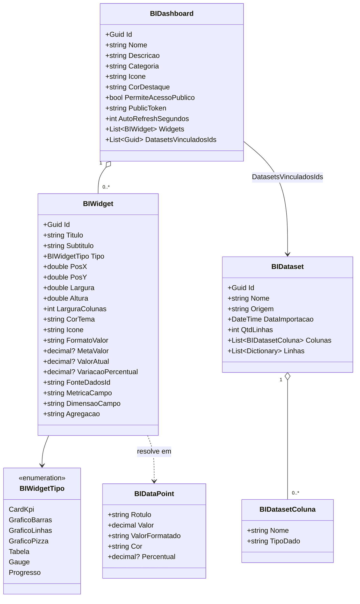
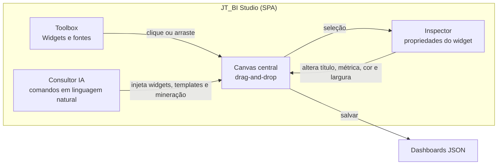
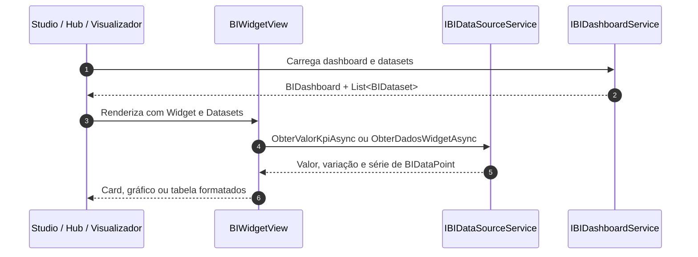
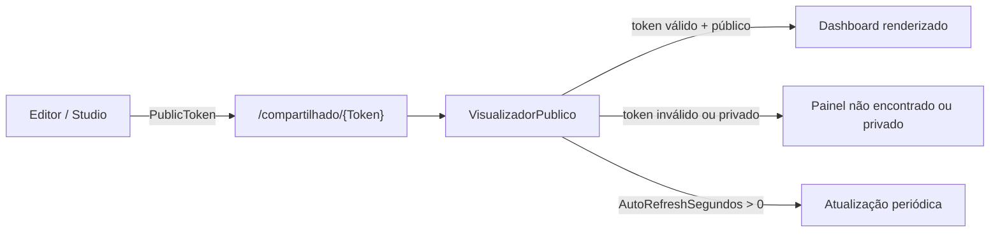
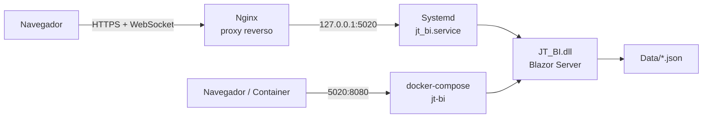

# 🏛️ Documento de Arquitetura de Software — JT_BI

Este documento descreve as decisões arquiteturais, a organização em camadas, os padrões de projeto, os fluxos de dados e os mecanismos de persistência, segurança e compartilhamento adotados no módulo **JT_BI**.

O **JT_BI** é o módulo de Business Intelligence e Analytics da plataforma **JT Sistemas**, construído sobre **.NET 10** com **Blazor Web App (Interactive Server)**. Ele não é uma aplicação isolada: consome diretamente a camada compartilhada `JT_ApplicationLayer` para autenticação, menus, tutoriais, componentes visuais e serviços de domínio.

---

## 1. Visão Geral da Arquitetura

A solução adota um modelo de **host único Blazor Server** com separação interna por responsabilidades (apresentação, serviços de BI, modelos e persistência). Diferentemente dos módulos Web/MAUI do ecossistema, o JT_BI não possui projetos separados de UI compartilhada: toda a interface analítica é implementada no próprio projeto e reutiliza o layout e os componentes base de `JT_UserInterface.Shared`.

### Diagrama de Camadas



### Princípios Norteadores

1. **Interactive Server como padrão:** toda a interatividade (drag-and-drop, canvas, inspector, mineração e chat consultivo) executa no servidor e trafega por SignalR. Não há projeto WebAssembly no JT_BI.
2. **Baixo acoplamento com a plataforma:** autenticação, permissões, menus e tutoriais são obtidos por interfaces de `JT_UserInterface.Shared` e `JT_Servicos`, permitindo que o módulo seja embarcado no ecossistema JT.
3. **Persistência simples e portátil:** dashboards e datasets são persistidos em arquivos JSON no diretório de conteúdo da aplicação, sem dependência de ORM ou schema de banco para o funcionamento do BI.
4. **Extensibilidade por catálogo:** as fontes de dados são descritas por metadados (`FonteDadosInfo`) e resolvidas por contrato (`IBIDataSourceService`), permitindo substituir os dados demonstrativos por consultas reais sem alterar o editor visual.

---

## 2. Estrutura do Projeto

| Caminho | Responsabilidade |
| :--- | :--- |
| `Program.cs` | Composição da aplicação, registro de serviços, configuração estática do ecossistema JT, pipeline HTTP e mapeamento dos componentes Blazor. |
| `Components/App.razor` | Documento raiz HTML e pontos de montagem do Blazor (`HeadOutlet`, `Routes`). |
| `Components/Routes.razor` | Roteador com assembly adicional de `JT_UserInterface.Shared` e layout padrão compartilhado. |
| `Components/Pages/` | Páginas roteáveis do módulo: Studio, Hub, Editor, Visualizador Público e páginas de infraestrutura. |
| `Components/BI/` | Componentes reutilizáveis de visualização, importação e compartilhamento de dashboards. |
| `Components/Layout/` | Layout local usado pelo visualizador público, menu legado e modal de reconexão do Blazor Server. |
| `Services/` | Serviços de aplicação do BI, provedores de menu/tutorial e armazenamento seguro web. |
| `Models/` | Modelo de domínio analítico: dashboards, widgets, datasets e pontos de dados. |
| `Data/` | Diretório de persistência dos arquivos `dashboards.json` e `datasets.json` (criado em tempo de execução). |
| `deploy/` | Unit file do Systemd, configuração Nginx com WebSockets e scripts de publicação. |
| `Dockerfile` / `docker-compose.yml` | Empacotamento multi-estágio da aplicação e execução em container. |

### Rotas da Aplicação

| Rota | Página | Finalidade |
| :--- | :--- | :--- |
| `/`, `/bi`, `/bidashboard`, `/home` | `BIDashboardPage.razor` | Studio BI (SPA analítica) com canvas, toolbox, inspector, mineração e consultor de IA. |
| `/dashboards` | `DashboardsHub.razor` | Hub com indicadores gerais e gestão de todos os painéis. |
| `/dashboards/editor/{Id:guid}` | `EditorDashboard.razor` | Construtor visual dedicado, com movimentação, redimensionamento e reorganização automática. |
| `/compartilhado/{Token}` | `VisualizadorPublico.razor` | Modo apresentação público, sem exigência de login, com tema claro/escuro e auto-refresh. |
| `/Error`, `/not-found` | `Error.razor`, `NotFound.razor` | Tratamento de exceções e rotas inexistentes. |
| `/counter`, `/weather` | `Counter.razor`, `Weather.razor` | Páginas de exemplo herdadas do template Blazor, sem papel no domínio de BI. |

---

## 3. Inicialização e Injeção de Dependências

O `Program.cs` centraliza a composição da aplicação:

```csharp
builder.Services.AddRazorComponents()
    .AddInteractiveServerComponents();

Config.SetInstancia(builder.Configuration.GetSection("Config").Get<Config>());
FirebaseConfig.SetInstancia(builder.Configuration.GetSection("Config:FirebaseConfig").Get<FirebaseConfig>());

builder.Services.AddScoped<ISecureStorageService, WebSecureStorageService>();
builder.Services.AddJTUserInterface();

builder.Services.AddScoped<IJwtTokenService, JwtTokenService>();
builder.Services.AddScoped<JwtTokenService>();

builder.Services.AddScoped<IMenuProvider, BIMenuProvider>();
builder.Services.AddScoped<IModuloMenuProvider, BIMenuProvider>();
builder.Services.AddScoped<ITutorialProvider, BITutorialProvider>();

builder.Services.AddSingleton<IBIDashboardService, BIDashboardService>();
builder.Services.AddSingleton<IBIDataSourceService, BIDataSourceService>();
builder.Services.AddSingleton<IBIImportService, BIImportService>();
builder.Services.AddSingleton<IBIDataMiningService, BIDataMiningService>();
```

### Decisões de Ciclo de Vida

- **Serviços de BI como `Singleton`:** o estado analítico (cache de dashboards/datasets e o semáforo de escrita) é compartilhado por todo o processo. Isso evita leituras concorrentes inconsistentes do arquivo JSON e mantém o comportamento do Studio estável entre circuitos Blazor.
- **Serviços de plataforma como `Scoped`:** menu, tutorial, armazenamento seguro e token JWT acompanham o escopo do circuito do usuário.
- **Configurações estáticas:** `Config` e `FirebaseConfig` são inicializadas no host e expostas como instâncias únicas para os serviços compartilhados.

### Pipeline HTTP

O host configura `ForwardedHeaders` para operar atrás de proxy reverso, redirecionamento HTTPS, antiforgery e ativos estáticos. Os componentes são mapeados com `AddInteractiveServerRenderMode()` e o assembly de `JT_UserInterface.Shared` é adicionado como assembly adicional de roteamento.

Não há endpoints Minimal API próprios no JT_BI: a superfície HTTP é composta pelos componentes Blazor e pelo pipeline de assets.

---

## 4. Modelo de Domínio

O domínio foi desenhado para representar painéis analíticos configuráveis, sem dependência de schema relacional.



### 4.1. `BIDashboard`

Representa um painel analítico completo. Além dos metadados visuais (nome, descrição, categoria, ícone e cor), concentra as regras de compartilhamento:

- `PublicToken`: token opaco (`Guid` sem hífens) usado na rota `/compartilhado/{Token}`.
- `PermiteAcessoPublico`: habilita ou revoga o acesso por link.
- `AutoRefreshSegundos`: intervalo de atualização automática no modo apresentação (`0` desliga).
- `Widgets`: coleção ordenada de componentes analíticos.
- `DatasetsVinculadosIds`: datasets importados associados ao painel.

### 4.2. `BIWidget`

É a unidade visual e analítica do painel. Possui duas dimensões de layout:

1. **Posicionamento absoluto percentual** (`PosX`, `PosY`, `Largura`, `Altura`) para o canvas livre do editor.
2. **Largura em colunas** (`LarguraColunas`) para a grade responsiva do visualizador público.

A vinculação de dados é declarativa: `FonteDadosId` aponta para uma fonte de catálogo (`financeiro`, `food`, `vendas`, `estoque`) ou para um dataset importado no formato `dataset_{Guid}`. A combinação `MetricaCampo` + `DimensaoCampo` + `Agregacao` determina como o valor será calculado.

### 4.3. `BIDataset`

Armazena dados tabulares importados de CSV ou JSON. As colunas carregam o tipo inferido (`Texto` ou `Numero`) e as linhas são dicionários dinâmicos, o que permite ao editor oferecer métricas e dimensões sem um schema fixo.

---

## 5. Serviços e Responsabilidades

| Contrato | Implementação | Ciclo de Vida | Responsabilidade |
| :--- | :--- | :--- | :--- |
| `IBIDashboardService` | `BIDashboardService` | Singleton | CRUD de dashboards/datasets, cache em memória, persistência JSON, duplicação, token público e sanitização. |
| `IBIDataSourceService` | `BIDataSourceService` | Singleton | Catálogo de fontes, resolução de KPIs e séries de dados, agregações e leitura de datasets importados. |
| `IBIImportService` | `BIImportService` | Singleton | Importação de CSV/JSON, inferência de tipos e geração automática de dashboard. |
| `IBIDataMiningService` | `BIDataMiningService` | Singleton | K-Means bidimensional, Curva ABC, score de risco/churn e geração de widgets analíticos. |
| `IMenuProvider` / `IModuloMenuProvider` | `BIMenuProvider` | Scoped | Itens do menu lateral integrados ao layout compartilhado. |
| `ITutorialProvider` | `BITutorialProvider` | Scoped | Definição dos tours guiados do Studio e do Hub. |
| `ISecureStorageService` | `WebSecureStorageService` | Scoped | Persistência de tokens no `localStorage` com tratamento de prerendering e desconexão. |

### 5.1. `BIDashboardService` e a Persistência JSON

O serviço de dashboards é o núcleo de estado do módulo:

- **Cache preguiçoso:** os arquivos só são lidos na primeira operação de cada coleção.
- **Concorrência controlada:** um `SemaphoreSlim(1,1)` serializa leituras de carga e escritas.
- **Seed inicial:** quando `dashboards.json` não existe, dois painéis demonstrativos são criados (`Visão Executiva 360°` e `Performance Restaurante & Food`).
- **Sanitização:** ao carregar, textos com problemas de encoding são normalizados e larguras de colunas incompatíveis são corrigidas conforme o tipo do widget.
- **Resiliência:** falhas de escrita são registradas no console sem derrubar a aplicação, preservando o cache em memória.

### 5.2. `BIDataSourceService` e o Catálogo Analítico

O serviço expõe quatro fontes de dados prontas:

| Fonte | Métricas | Dimensões |
| :--- | :--- | :--- |
| `financeiro` | Faturamento, Despesas, Lucro Líquido, Inadimplência, Saldo Caixa | Mês, Centro de Custo, Forma Pagamento, Conta Bancária |
| `food` | Faturamento Restaurante, Ticket Médio, Qtd Pedidos, Giro Mesas, Tempo Médio | Categoria Cardápio, Ambiente Salão, Turno, Garçom |
| `vendas` | Novos Leads, Taxa Conversão, Vendas Fechadas, Valor Pipeline | Canal Aquisição, Vendedor, Status Negócio, Segmento |
| `estoque` | Valor Total Estoque, Itens Críticos, Giro Estoque, Perdas/Descarte | Grupo Produto, Fornecedor, Local Armazenagem |

Para a fonte `dataset_{id}`, o serviço agrupa as linhas pela dimensão escolhida e aplica a agregação configurada (`Soma`, `Media`, `Contagem`). Para as fontes de catálogo, os valores são demonstrativos e servem como contrato de integração para futuras consultas reais (SQL ou API).

### 5.3. `BIImportService`

O importador aceita dois formatos:

- **CSV:** detecta automaticamente o delimitador (`;`, `,` ou tabulação), lê o cabeçalho, converte as linhas e infere colunas numéricas quando mais de 70% de uma amostra de 20 registros é numérica.
- **JSON:** espera um array de objetos e infere tipo por valor (`Number` ou texto).

Após a importação, `GerarDashboardAutomatico` cria um painel com cinco widgets: três KPIs (total, média e contagem) e dois gráficos (barras e pizza), vinculados ao dataset pelo identificador `dataset_{Guid}`.

### 5.4. `BIDataMiningService`

O laboratório de mineração implementa algoritmos diretamente em C#, sem dependências externas:

- **K-Means:** clusterização em duas dimensões numéricas, com `k` limitado entre 2 e 5, inicialização determinística (`Random(42)`) e no máximo 50 iterações.
- **Curva ABC:** ordenação decrescente por valor e classificação acumulada em A (até 80%), B (até 95%) e C (restante).
- **Score de Risco/Churn:** combina dias sem comprar (peso maior, limitado a 60 pontos) e quantidade de cancelamentos (até 40 pontos), resultando em categorias `Baixo`, `Médio` ou `Crítico`.
- **Geração de widgets:** converte resultados de clusterização e Curva ABC em KPIs, gráficos e tabelas injetados diretamente no canvas.

---

## 6. Studio BI e Experiência de Edição

A página principal (`/`) implementa uma SPA analítica dividida em três áreas:



### 6.1. Canvas e Drag-and-Drop

- Cada widget pode ser inserido por clique ou arrastado da toolbox para a área central.
- O posicionamento é percentual, permitindo que o layout se adapte a diferentes resoluções.
- O editor dedicado (`/dashboards/editor/{Id}`) adiciona movimentação, redimensionamento, duplicação, exclusão e reorganização automática dos widgets.

### 6.2. Templates

O Studio oferece três modelos prontos:

1. **Executivo:** KPIs financeiros e evolução temporal.
2. **Operacional:** comparativos por categoria, canais e visão de vendas.
3. **Mineração & IA:** estrutura voltada a clusterização, Curva ABC e indicadores de risco.

Os templates podem ser aplicados pelo modal ou acionados pelo Consultor de IA.

### 6.3. Consultor de IA

O consultor do Studio é um **motor local de intenção baseado em palavras-chave**, não uma chamada a um LLM externo. Ele interpreta comandos como `kmeans`, `abc`, `executivo`, `operacional`, `barra`, `linha`, `pizza`, `kpi` e `limpar`, executa a ação correspondente no canvas e responde no histórico do chat. Essa decisão mantém o módulo autônomo e sem custo de inferência, deixando a integração com provedores de IA como ponto de extensão.

### 6.4. Exportação

O botão **Exportar** serializa o dashboard ativo em JSON indentado e copia o conteúdo para a área de transferência, permitindo versionar ou transportar a definição do painel.

---

## 7. Renderização de Widgets e Fluxo de Dados

O componente `BIWidgetView` é o renderizador único de todos os tipos de widget:



- **KPIs:** exibem valor formatado (`Moeda`, `Numero`, `Percentual`, `Decimal`), variação percentual e, quando configurada, barra de progresso de meta.
- **Gráficos:** barras em CSS, linhas em SVG com gradiente e pizza via `conic-gradient`, sem biblioteca gráfica externa.
- **Tabelas:** listam dimensão, métrica e percentual.
- **Formatação:** centralizada no componente, garantindo consistência entre Studio e visualizador público.

---

## 8. Compartilhamento Público

O compartilhamento é baseado em **link opaco com token**, e não em autenticação do visitante:

1. Cada dashboard nasce com `PublicToken` e `PermiteAcessoPublico = true`.
2. O `BIShareModal` permite revogar o acesso, copiar o link e definir o intervalo de auto-refresh.
3. `ObterPorTokenPublicoAsync` só retorna o painel quando o token existe **e** o compartilhamento está habilitado.
4. O `VisualizadorPublico` usa layout local próprio, oferece alternância claro/escuro, atualização automática por timer e um atalho para abrir o dashboard no construtor.



> [!IMPORTANT]
> O link público concede leitura do painel a qualquer pessoa que possua o token. Não há escopo por usuário, expiração automática ou auditoria de acesso no modelo atual.

---

## 9. Segurança e Controle de Acesso

### 9.1. Acesso ao Studio

O acesso ao painel principal é validado no componente `BIDashboardPage`:

- Se o usuário não estiver autenticado, o conteúdo não é renderizado e um convite para login é exibido (`/login?returnUrl=/`).
- Perfis `Administrador` e `Supervisor` têm acesso pleno.
- Os demais perfis dependem de `AcessoService.TemPermissaoAsync(eModuloSistema.Gestao, eAcaoPermissao.Ler)`.
- O estado de autenticação é observado por `CurrentUserState.OnStateChanged`, permitindo revalidar o acesso quando a sessão muda.

O `Program.cs` não registra `UseAuthentication`/`UseAuthorization`; a proteção é aplicada na camada de componente. O visualizador público é deliberadamente anônimo.

### 9.2. Tokens e Armazenamento

O host registra `ISecureStorageService` com `WebSecureStorageService`, que persiste valores no `localStorage` via JS Interop e trata dois cenários críticos do Blazor Server:

- `InvalidOperationException` durante o prerendering, quando o JS Interop ainda não está disponível.
- `JSDisconnectedException` quando o circuito é encerrado.

O `JwtTokenService` e o `HttpClient` com `JwtAuthorizationHandler` são fornecidos pela camada compartilhada `JT_UserInterface.Shared`.

### 9.3. Borda e Proxy Reverso

O host habilita `ForwardedHeaders` (`X-Forwarded-For` e `X-Forwarded-Proto`) para preservar scheme e IP do cliente atrás do Nginx. Em produção, a aplicação escuta apenas em `127.0.0.1:5020`, e o Nginx expõe o domínio público com suporte a WebSockets e timeouts longos para o SignalR.

### 9.4. Configuração e Segredos

`Config` e `FirebaseConfig` são carregados de `appsettings.json` e mantidos como instâncias estáticas. Em produção, valores sensíveis devem ser sobrescritos por variáveis de ambiente, `appsettings.Production.json` (ignorado pelo Git) ou cofre de segredos, seguindo a governança descrita em [DEPLOY.md](../DEPLOY.md).

---

## 10. Deploy e Topologia de Execução

O JT_BI é publicado como aplicação ASP.NET Core autocontida e pode operar em dois modelos:



| Modelo | Descrição |
| :--- | :--- |
| **VPS Linux (Systemd + Nginx)** | Modelo principal do ecossistema JT. O serviço roda em `127.0.0.1:5020` e o Nginx faz proxy com `Upgrade`/`Connection` para SignalR. |
| **Container** | `Dockerfile` multi-estágio com runtime .NET 10 e usuário não-root. O `docker-compose.yml` publica a porta `5020` do host para `8080` do container. |

O pipeline de GitHub Actions publica em Release, envia os binários por `rsync` sobre SSH, preserva configurações locais e reinicia o serviço, validando em seguida se o processo permanece ativo. Os detalhes operacionais, secrets e comandos de diagnóstico estão em [DEPLOY.md](../DEPLOY.md).

---

## 11. Pontos de Extensão e Evolução

A arquitetura atual prioriza autonomia e baixo acoplamento. Os principais pontos de evolução são:

1. **Fonte de dados real por tenant:** substituir os valores demonstrativos de `BIDataSourceService` por implementações que consultem `JT_Servicos`, a API JTech ou o banco do cliente, mantendo o contrato `IBIDataSourceService`.
2. **Persistência plugável:** extrair uma abstração de repositório para dashboards/datasets e adicionar implementações SQL/NoSQL, preservando o serviço atual baseado em JSON como fallback local.
3. **IA generativa:** trocar o motor local de palavras-chave por um provedor de LLM da plataforma, com contexto do dashboard e das fontes conectadas.
4. **Autorização de borda:** complementar a validação por componente com políticas de autorização no pipeline, especialmente para futuras APIs de dados.
5. **Observabilidade:** instrumentar métricas de uso do Studio, tempo de resolução de widgets e falhas de persistência para diagnóstico em produção.

---

## 12. Referências

- [README do projeto](../README.md)
- [Guia de Deploy e Governança](../DEPLOY.md)
- [Arquitetura da camada compartilhada](../../JT_ApplicationLayer/docs/ARQUITETURA.md)
- [Solução JT_Finance (padrão de UI compartilhada e multi-tenant)](../../JT_Finance/docs/ARQUITETURA.md)
- [Solução JT_Food (padrão de renderização híbrida e integração)](../../JT_Food/docs/ARQUITETURA.md)
