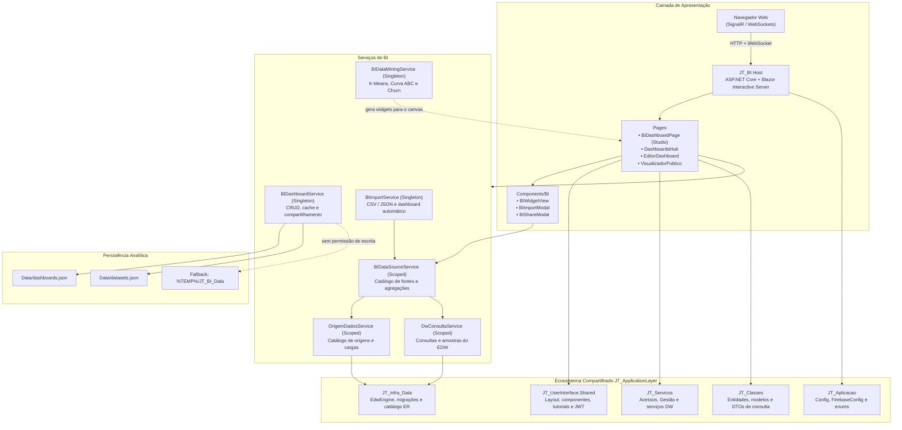
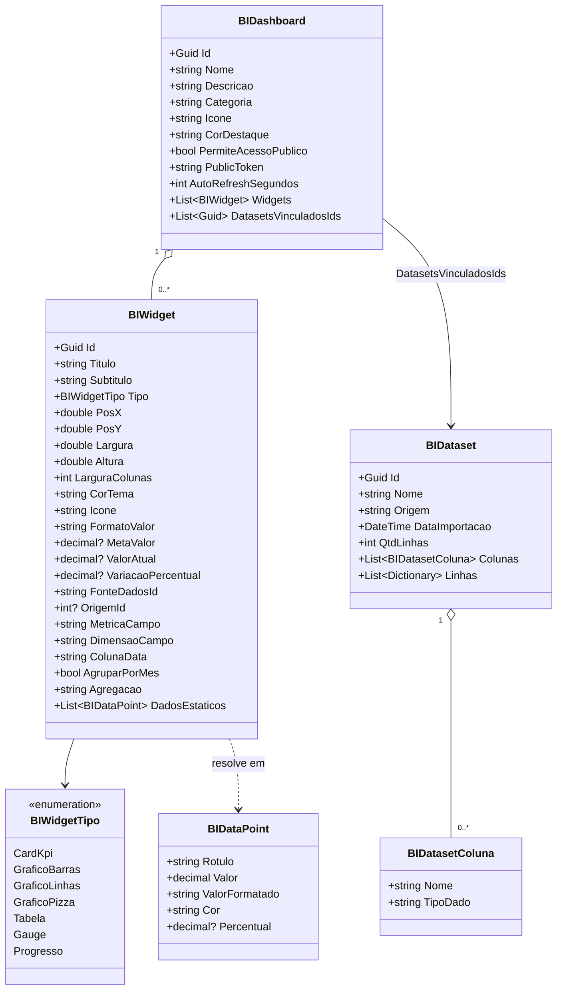
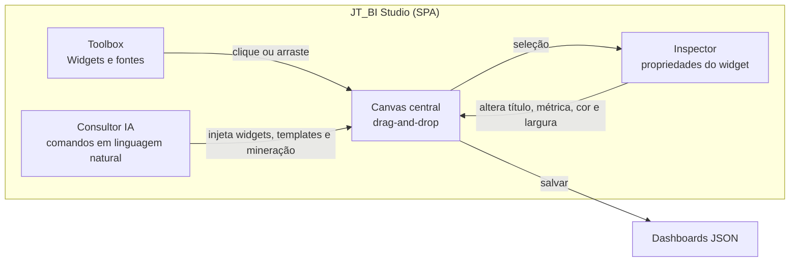
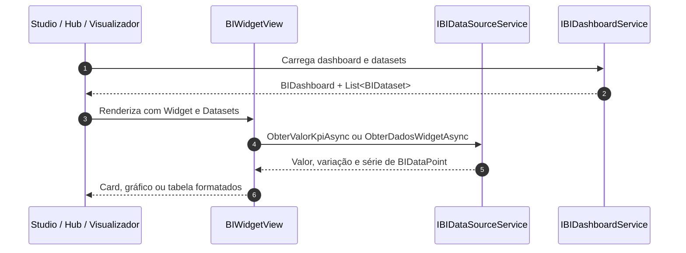
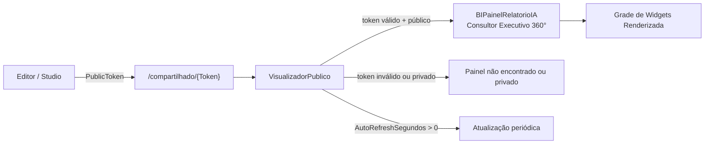
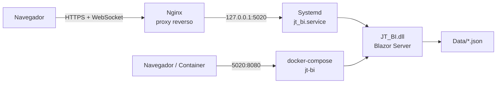

# 🏛️ Documento de Arquitetura de Software — JT_BI

Este documento descreve as decisões arquiteturais, a organização em camadas, os padrões de projeto, os fluxos de dados e os mecanismos de persistência, segurança e compartilhamento adotados no módulo **JT_BI**.

O **JT_BI** é o módulo de Business Intelligence e Analytics da plataforma **JT Sistemas**, construído sobre **.NET 10** com **Blazor Web App (Interactive Server)**. Ele não é uma aplicação isolada: consome diretamente a camada compartilhada `JT_ApplicationLayer` para autenticação, menus, tutoriais, componentes visuais e serviços de domínio.

---

## 1. Visão Geral da Arquitetura

A solução adota um modelo de **host único Blazor Server** com separação interna por responsabilidades (apresentação, serviços de BI, modelos e persistência). Diferentemente dos módulos Web/MAUI do ecossistema, o JT_BI não possui projetos separados de UI compartilhada: toda a interface analítica é implementada no próprio projeto e reutiliza o layout e os componentes base de `JT_UserInterface.Shared`.

### Diagrama de Camadas



### Princípios Norteadores

1. **Interactive Server como padrão:** toda a interatividade (drag-and-drop, canvas, inspector, mineração e chat consultivo) executa no servidor e trafega por SignalR. Não há projeto WebAssembly no JT_BI.
2. **Baixo acoplamento com a plataforma:** autenticação, permissões, menus e tutoriais são obtidos por interfaces de `JT_UserInterface.Shared` e `JT_Servicos`, permitindo que o módulo seja embarcado no ecossistema JT.
3. **Persistência simples e portátil:** dashboards e datasets são persistidos em arquivos JSON no diretório de conteúdo da aplicação, sem dependência de ORM ou schema de banco para o funcionamento do BI.
4. **Extensibilidade por catálogo:** as fontes de dados são descritas por metadados (`FonteDadosInfo`) e resolvidas por contrato (`IBIDataSourceService`), permitindo alternar entre origens reais do EDW e fontes demonstrativas sem alterar o editor visual.

---

## 2. Estrutura do Projeto

| Caminho | Responsabilidade |
| :--- | :--- |
| `Program.cs` | Composição da aplicação, registro de serviços, configuração estática do ecossistema JT, pipeline HTTP e mapeamento dos componentes Blazor. |
| `Components/App.razor` | Documento raiz HTML e pontos de montagem do Blazor (`HeadOutlet`, `Routes`). |
| `Components/Routes.razor` | Roteador com assembly adicional de `JT_UserInterface.Shared` e layout padrão `BILayout` (que aninha o layout compartilhado e o host global de importação). |
| `Components/Pages/` | Páginas roteáveis do módulo: Studio, Hub, Editor, Visualizador Público e páginas de infraestrutura. |
| `Components/BI/` | Componentes reutilizáveis de visualização, importação e compartilhamento de dashboards. |
| `Components/Layout/` | `BILayout` (layout padrão com host de importação), `PublicLayout` (apresentação sem menu) e menu legado. |
| `Services/` | Serviços de aplicação do BI, provedores de menu/tutorial e armazenamento seguro web. |
| `Models/` | Modelo de domínio analítico: dashboards, widgets, datasets e pontos de dados. |
| `Data/` | Diretório de persistência dos arquivos `dashboards.json` e `datasets.json` (criado em tempo de execução). |
| `tests/JT_BI.Tests/` | Projeto NUnit com testes unitários dos algoritmos de mineração (`dotnet test`), excluído do build e do publish do host. |
| `deploy/` | Unit file do Systemd, configuração Nginx com WebSockets e scripts de publicação. |
| `Dockerfile` / `docker-compose.yml` | Empacotamento multi-estágio da aplicação e execução em container. |

### Rotas da Aplicação

| Rota | Página | Finalidade |
| :--- | :--- | :--- |
| `/`, `/bi`, `/bidashboard`, `/home` | `BIDashboardPage.razor` | Studio BI (SPA analítica) com canvas, toolbox, inspector, mineração e consultor de IA. |
| `/dashboards` | `DashboardsHub.razor` | Hub com indicadores gerais e gestão de todos os painéis. |
| `/dashboards/editor/{Id:guid}` | `EditorDashboard.razor` | Construtor visual dedicado, com movimentação, redimensionamento e reorganização automática. |
| `/compartilhado/{Token}` | `VisualizadorPublico.razor` | Modo apresentação público sem login obrigatório, com tema claro/escuro, auto-refresh, layout padrão da User Interface JT com botão Entrar e menu lateral condicional ao painel. |
| `/Error`, `/not-found` | `Error.razor`, `NotFound.razor` | Tratamento de exceções e rotas inexistentes. |
| `/counter`, `/weather` | `Counter.razor`, `Weather.razor` | Páginas de exemplo herdadas do template Blazor, sem papel no domínio de BI. |

---

## 3. Inicialização e Injeção de Dependências

O `Program.cs` centraliza a composição da aplicação:

```csharp
var builder = WebApplication.CreateBuilder(args);

builder.WebHost.ConfigureKestrel(serverOptions =>
{
    // Permite payloads e uploads de arquivos de até 5 GB
    serverOptions.Limits.MaxRequestBodySize = 5L * 1024 * 1024 * 1024;
});

builder.Services.AddRazorComponents()
    .AddInteractiveServerComponents()
    .AddHubOptions(options =>
    {
        // Suporta uploads de grandes arquivos (até 5 GB) e mensagens SignalR sem interrupção de circuito
        options.MaximumReceiveMessageSize = null;
        options.ClientTimeoutInterval = TimeSpan.FromMinutes(15);
        options.HandshakeTimeout = TimeSpan.FromSeconds(60);
        options.KeepAliveInterval = TimeSpan.FromSeconds(15);
    });

Config.SetInstancia(builder.Configuration.GetSection("Config").Get<Config>());
FirebaseConfig.SetInstancia(builder.Configuration.GetSection("Config:FirebaseConfig").Get<FirebaseConfig>());

builder.Services.AddScoped<ISecureStorageService, WebSecureStorageService>();
builder.Services.AddJTUserInterface();

// Decoração do IModuloVerificacaoService para assegurar que eModuloSistema.IA esteja sempre ativo no BI
builder.Services.AddScoped<IModuloVerificacaoService, BIModuloVerificacaoService>();

builder.Services.AddScoped<IJwtTokenService, JwtTokenService>();
builder.Services.AddScoped<JwtTokenService>();

builder.Services.AddScoped<IMenuProvider, BIMenuProvider>();
builder.Services.AddScoped<IModuloMenuProvider, BIMenuProvider>();
builder.Services.AddScoped<ITutorialProvider, BITutorialProvider>();

builder.Services.AddSingleton<IBIDashboardService, BIDashboardService>();
builder.Services.AddScoped<IBIDataSourceService, BIDataSourceService>();
builder.Services.AddSingleton<IBIImportService, BIImportService>();
builder.Services.AddSingleton<IBIDataMiningService, BIDataMiningService>();
builder.Services.AddScoped<IBIMineracaoAgenteService, BIMineracaoAgenteService>();
builder.Services.AddScoped<JT_Servicos.IA.ConfiguracaoIAService>();

builder.Services.AddScoped<JT_Servicos.DW.OrigemDadosService>();
builder.Services.AddScoped<JT_Servicos.DW.DwConsultaService>();
builder.Services.AddScoped<JT_Servicos.DW.IndicadorDashboardService>();
```

### Decisões de Ciclo de Vida

- **Estado analítico como `Singleton`:** `BIDashboardService`, `BIImportService` e `BIDataMiningService` concentram cache de dashboards/datasets e algoritmos sem estado por usuário. O semáforo de escrita do serviço de dashboards serializa operações no arquivo JSON e mantém o Studio estável entre circuitos Blazor.
- **Agente de IA e ML como `Scoped`:** `BIMineracaoAgenteService` e `ConfiguracaoIAService` utilizam o contexto HTTP do circuito e a configuração de chaves do usuário (Gemini / OpenAI).
- **Acesso a dados como `Scoped`:** `BIDataSourceService` depende de `OrigemDadosService` e `DwConsultaService`, que usam `HttpClient` por circuito (modo API) e a conexão multi-tenant resolvida por request (`BaseRepository.StringConexaoProvider`) no modo local.
- **Verificação de Módulos:** `BIModuloVerificacaoService` assegura que `eModuloSistema.IA` seja reconhecido como ativo, viabilizando a injeção da aba padrão de IA em `/configuracoes`.
- **Configurações estáticas:** `Config` e `FirebaseConfig` são inicializadas no host e expostas como instâncias únicas para os serviços compartilhados.

### Pipeline HTTP

O host configura `ForwardedHeaders` para operar atrás de proxy reverso, redirecionamento HTTPS, antiforgery e ativos estáticos. Os componentes são mapeados com `AddInteractiveServerRenderMode()` e o assembly de `JT_UserInterface.Shared` é adicionado como assembly adicional de roteamento.

Não há endpoints Minimal API próprios no JT_BI: a superfície HTTP é composta pelos componentes Blazor e pelo pipeline de assets.

---

## 4. Modelo de Domínio

O domínio foi desenhado para representar painéis analíticos configuráveis, sem dependência de schema relacional.



### 4.1. `BIDashboard`

Representa um painel analítico completo. Além dos metadados visuais (nome, descrição, categoria, ícone e cor), concentra as regras de compartilhamento:

- `PublicToken`: token opaco (`Guid` sem hífens) usado na rota `/compartilhado/{Token}`.
- `PermiteAcessoPublico`: habilita ou revoga o acesso por link.
- `AutoRefreshSegundos`: intervalo de atualização automática no modo apresentação (`0` desliga).
- `Widgets`: coleção ordenada de componentes analíticos.
- `DatasetsVinculadosIds`: datasets importados associados ao painel.
- `UsuarioId`, `UsuarioUid` e `UsuarioNome`: dono do painel. Dashboards antigos sem dono são tratados como **compartilhados** e continuam visíveis para todos os usuários autenticados.

### 4.2. `BIWidget`

É a unidade visual e analítica do painel. Possui duas dimensões de layout perfeitamente integradas:

1. **Posicionamento percentual** (`PosX`, `PosY`, `Largura`, `Altura`): utilizado no canvas de edição visual.
2. **Grade responsiva Bootstrap de 12 colunas** (`LarguraColunas`): define as classes (`col-12`, `col-12 col-xl-8`, `col-12 col-lg-6`, `col-12 col-sm-6 col-lg-4`, `col-12 col-sm-6 col-lg-3`).

> [!NOTE]
> `BIWidget` possui **sincronização bidirecional automática** entre `Largura` (percentual) e `LarguraColunas` (grade 1 a 12). Definir `LarguraColunas = 12` calcula `Largura = 100%`, `LarguraColunas = 8` calcula `66.7%`, `6` calcula `50%`, `4` calcula `33.3%` e `3` calcula `25%`. Isso garante que o tamanho configurado no construtor de widgets e no editor seja respeitado tanto no Studio quanto no visualizador público.

A vinculação de dados é declarativa e resolvida em `BIDataSourceService`:

- `origem_{id}` (ou `OrigemId`) aponta para uma origem carregada no EDW; `MetricaCampo`, `ColunaData`, `AgruparPorMes` e `Agregacao` montam a consulta.
- `dataset_{Guid}` aponta para um dataset importado por CSV/JSON.
- `mineracao` usa `DadosEstaticos` materializados pelos algoritmos de mineração.
- Os identificadores `financeiro`, `food`, `vendas` e `estoque` permanecem como **fontes demonstrativas** quando nenhuma origem EDW está configurada.

### 4.3. `BIDataset`

Armazena dados tabulares importados de CSV ou JSON (suportando arquivos de **até 5 GB**). As colunas carregam o tipo inferido (`Texto` ou `Numero`) e as linhas são dicionários dinâmicos, o que permite ao editor oferecer métricas e dimensões sem um schema fixo.

Assim como os dashboards, datasets possuem `UsuarioId`, `UsuarioUid` e `UsuarioNome`. Datasets antigos sem dono permanecem compartilhados. A leitura por vínculo (`ObterDatasetsPorIdsAsync`) ignora o filtro de dono, permitindo que um painel público renderize apenas os datasets aos quais foi explicitamente associado.

---

## 5. Serviços e Responsabilidades

| Contrato | Implementação | Ciclo de Vida | Responsabilidade |
| :--- | :--- | :--- | :--- |
| `IBIDashboardService` | `BIDashboardService` | Singleton | CRUD de dashboards/datasets, cache em memória, persistência JSON, duplicação, token público e sanitização não-destrutiva de widgets. |
| `IBIDataSourceService` | `BIDataSourceService` | Scoped | Catálogo de origens EDW, resolução de KPIs e séries, agregações, leitura de datasets e amostras para mineração. |
| `IBIImportService` | `BIImportService` | Singleton | Importação de CSV/JSON em streaming assíncrono (até 5 GB), inferência de tipos e geração automática de dashboard. |
| `IBIDataMiningService` | `BIDataMiningService` | Singleton | K-Means Multidimensional (z-score + silhueta), Curva ABC (Pareto 80/95), Previsão de Churn com ML.NET FastTree e injeção de widgets. |
| `IBIMineracaoAgenteService` | `BIMineracaoAgenteService` | Scoped | Agente analítico CRISP-DM com suporte a Google Gemini e OpenAI-compatible, com fallback heurístico e revisor metodológico. |
| `ConfiguracaoIAService` | `ConfiguracaoIAService` | Scoped | Parametrização de API Keys (Gemini/OpenAI), persistência de configurações de IA e descoberta de modelos. |
| `IModuloVerificacaoService` | `BIModuloVerificacaoService` | Scoped | Decorador de verificação garantindo que o módulo `eModuloSistema.IA` esteja sempre ativo no BI. |
| `OrigemDadosService` | `OrigemDadosService` | Scoped | Catálogo de origens, modelo de entidades e execução de cargas no EDW (API ou SQL local). |
| `DwConsultaService` | `DwConsultaService` | Scoped | Consultas agregadas e amostras somente leitura sobre `Fato_{TabelaOrigem}`. |
| `IndicadorDashboardService` | `IndicadorDashboardService` | Scoped | Cálculo de indicadores, painéis e séries a partir das origens EDW. |
| `IMenuProvider` / `IModuloMenuProvider` | `BIMenuProvider` | Scoped | Itens do menu lateral integrados ao layout compartilhado. |
| `IImportacaoDadosProvider` | `BIImportacaoProvider` | Scoped | Redireciona a importação do assistente de IA para o `BIImportModal`. |
| `ITutorialProvider` | `BITutorialProvider` | Scoped | Definição dos tours guiados do Studio e do Hub. |
| `ISecureStorageService` | `WebSecureStorageService` | Scoped | Persistência de tokens no `localStorage` com tratamento de prerendering e desconexão. |

### 5.1. `BIDashboardService` e a Persistência JSON

O serviço de dashboards é o núcleo de estado do módulo:

- **Cache preguiçoso:** os arquivos só são lidos na primeira operação de cada coleção.
- **Concorrência controlada:** um `SemaphoreSlim(1,1)` serializa leituras de carga e escritas.
- **Seed inicial:** quando `dashboards.json` não existe, dois painéis demonstrativos são criados (`Visão Executiva 360°` e `Performance Restaurante & Food`).
- **Sanitização Inteligente:** normaliza encoding de caracteres e sincroniza colunas de layout sem sobrescrever configurações válidas já definidas no construtor do widget.
- **Resiliência:** falhas de escrita são registradas no console sem derrubar a aplicação, preservando o cache em memória.
- **Ownership:** as operações recebem um `BIUsuarioContexto` (ID/UID/nome e flag de acesso total). As listagens retornam apenas dashboards/datasets do próprio usuário ou sem dono; `Administrador` e `Supervisor` enxergam todos. Ao salvar, o dono original é preservado (impedindo troca de propriedade pela edição), e a duplicação atribui a cópia a quem duplicou. A edição de dataset de outro dono lança `UnauthorizedAccessException`.
- **Isolamento do cache:** leituras e gravações trabalham com cópias serializadas do dashboard, evitando que mutações da UI em um circuito alterem o cache global antes do salvamento.

### 5.2. `BIDataSourceService` e o Catálogo Analítico

O catálogo é montado dinamicamente a partir de `OrigemDadosService.GetAll()`:

- Cada origem cadastrada gera uma `FonteDadosInfo` com `Id = origem_{id}`, `OrigemId`, nome, descrição e a lista de colunas disponíveis (campos base + `alias_coluna` dos relacionamentos), usada tanto como métrica quanto como dimensão.
- Quando não há nenhuma origem cadastrada, o serviço retorna quatro fontes **demonstrativas** (`financeiro`, `food`, `vendas`, `estoque`), sinalizadas com `Demonstrativa = true`, permitindo navegar pelo editor antes da configuração do EDW.

| `FonteDadosId` | Comportamento |
| :--- | :--- |
| `origem_{id}` / `OrigemId` | Consulta o EDW via `DwConsultaService` (`ConsultaDwRequest`) com coluna de valor, dimensão, data, período, agrupamento mensal e agregação. |
| `dataset_{id}` | Agrupa as linhas importadas pela dimensão e aplica `Soma`, `Media` ou `Contagem`. |
| `mineracao` | Retorna os `DadosEstaticos` materializados pelos algoritmos. |
| `financeiro`, `food`, `vendas`, `estoque` | Valores demonstrativos (fallback). |

A agregação é mapeada para `eTipoOperacaoIndicador` (`Soma`, `Media`, `Contagem`, `Maximo`, `Minimo`). Para séries temporais, `AgruparPorMes` (ou dimensão `Mes`/`Periodo` com `ColunaData` preenchida) delega ao agrupamento `YEAR`/`MONTH` do SQL. `ObterAmostraAsync(origemId, colunas, limite)` entrega as linhas usadas pelo laboratório de mineração.

#### 5.2.1. Gestão de fontes no Studio

O painel **Fontes Conectadas** do Studio lista dinamicamente o resultado de `ObterFontesDisponiveisAsync()`, com selo `EDW` para origens reais e `DEMO` para as demonstrativas. O botão **Gerenciar fontes** abre `BIFontesModal`, que concentra o fluxo operacional sem sair do dashboard:

- **Criação rápida:** seleção da entidade do catálogo ER (`ObterModeloEntidadesAsync`), nome sugerido e toggle de relacionamentos. `BIOrigemFactory` monta `OrigemConfiguracao` com aliases únicos e pode criar a origem já executando a carga (`ExecutarCargaAsync`).
- **Operações por origem:** executar carga, editar (preservando colunas customizadas e ajustando relacionamentos) e excluir com confirmação em dois cliques. A lista exibe última execução, linhas carregadas e a última mensagem de status.
- **Gerenciador avançado:** link para `/gestao/edw`, onde é possível ajustar colunas individualmente.

Após qualquer criação, edição, exclusão ou carga, o modal dispara `OnChanged`; o Studio recarrega o catálogo e revalida a origem usada pela mineração.

### 5.3. `BIImportService`

O importador aceita dois formatos e processa arquivos de **até 5 GB**:

- **CSV:** detecta automaticamente o delimitador (`;`, `,` ou tabulação), lê o cabeçalho, converte as linhas e infere colunas numéricas quando mais de 70% de uma amostra de 20 registros é numérica.
- **JSON:** espera um array de objetos e infere tipo por valor (`Number` ou texto).

A entrada pode vir de três origens no modal de importação:

- **Arquivo:** `InputFile` com suporte a arquivos de **até 5 GB** via streaming em chunks; o nome do arquivo sugere o nome do dataset.
- **Link (URL):** download via `IHttpClientFactory`, restrito a HTTP/HTTPS e também suportando grandes arquivos. Requisições externas não recebem o token JWT.
- **Colar:** textarea para CSV/JSON, com detecção automática do formato.

Após a importação, `GerarDashboardAutomatico` cria um painel com cinco widgets: três KPIs (total, média e contagem) e dois gráficos (barras e pizza), vinculados ao dataset pelo identificador `dataset_{Guid}`. O dataset e o dashboard são salvos com o `BIUsuarioContexto` do usuário atual, respeitando o ownership.

O modal é único e global: `BILayout` hospeda `BIImportHost`, controlado por `BIImportUiService`. Assim, tanto os botões das páginas quanto o botão de importação do assistente de IA abrem o mesmo `BIImportModal`. Para isso, `ChatInstrutor` consulta `IImportacaoDadosProvider` e o JT_BI registra `BIImportacaoProvider`.

### 5.4. `BIDataMiningService` e `BIMineracaoAgenteService`

O laboratório de mineração implementa o ciclo analítico CRISP-DM com **ML.NET** e algoritmos avançados em C#:

- **Entrada & Tratamento:** Carrega registros do EDW ou Datasets, aplicando limpeza e deduplicação de chaves agregadas para evitar colisões.
- **K-Means Multidimensional:** Clusterização em $N$ dimensões normalizadas por z-score com suporte a escala logarítmica (`log1p`), cálculo do coeficiente de silhueta médio e rotulagem contextual dos grupos.
- **Curva ABC (Pareto 80/95):** Ordenação decrescente por valor monetário acumulado e classificação em classes A, B e C.
- **Previsão de Churn com ML.NET (FastTree):** Treinamento e inferência supervisionada baseada em recência, frequência e valor monetário, gerando probabilidade de cancelamento, categorização de risco e cálculo da receita exposta.
- **Agente LLM & Revisor Metodológico:** Integração com provedores Google Gemini e OpenAI-compatible via `ConfiguracaoIA` (com fallback heurístico determinístico), gerando parecer executivo e pontos críticos de atenção.
- **Geração de Widgets:** Injeta 10 widgets no Canvas com larguras Bootstrap de 12 colunas coordenadas em pares e larguras totais.

O detalhamento completo dos algoritmos, fórmulas e casos de teste está em [MINERACAO_DE_DADOS.md](MINERACAO_DE_DADOS.md).

### 5.5. `DwConsultaService` e os Endpoints `/api/dw`

`DwConsultaService` (em `JT_Servicos.DW`) é o ponto único de leitura analítica do EDW e é consumido tanto pelo Studio quanto pela API:

- **Modo API:** chama `POST /api/dw/consultar` e `POST /api/dw/amostra` pelo `HttpClient` do circuito, usando `BuildAbsoluteUrl`.
- **Modo local:** executa SQL parametrizado em `Fato_{TabelaOrigem}`, com a conexão EDW derivada por `EdwEngine.DerivarConexaoEdw(BaseRepository.StringConexaoProvider())`.
- **Snapshot:** toda consulta considera apenas o último `DataCarregamento` da tabela Fato.
- **Validação:** verifica existência da tabela e das colunas, exige `ColunaData` para filtro de período/agrupamento mensal e `ColunaValor` para `SUM`/`AVG`/`MIN`/`MAX`.
- **Limites:** consulta agregada com `Limite` entre 1 e 1.000 (padrão 20); amostra entre 1 e 5.000 linhas (padrão 1.000) e no máximo 50 colunas.

| Endpoint | Corpo | Retorno |
| :--- | :--- | :--- |
| `POST /api/dw/consultar` | `ConsultaDwRequest` (origem, valor, dimensão, data, período, agrupamento e agregação) | `ConsultaDwResultado` com `Pontos`, `Total` e `Sucesso` |
| `POST /api/dw/amostra` | `DwAmostraRequest` (origem, colunas e limite) | `DwAmostraResultado` com `Linhas` e `Sucesso` |

Rotas correlatas do grupo DW, usadas pelo catálogo de origens e pelos indicadores:

| Endpoint | Uso |
| :--- | :--- |
| `GET /api/origemdados/modelo` | Catálogo de entidades (ER) para montar uma origem. |
| `GET /api/origemdados/modelo/{classe}` | Modelo de uma entidade específica. |
| `POST /api/origemdados/executar/{id}` | Executa a carga ETL da origem no EDW. |
| `GET /api/indicadores-dashboard/painel?de=&ate=` | Indicadores resolvidos do painel. |
| `POST /api/indicadores-dashboard/calcular/{id}` | Recalcula um indicador no período informado. |
| `POST /api/indicadores-dashboard/serie/{id}` | Série mensal para gráficos. |

Os endpoints são mapeados em `DwConsultaEndpoints` e registrados por `MapDWEndpoints` em `JT_API/Endpoints/ModuloEndpointsExtensions.cs`. Eles não declaram política de autorização própria e ficam sujeitos à política global da API.

---

## 6. Studio BI e Experiência de Edição

A página principal (`/`) implementa uma SPA analítica dividida em três áreas:



### 6.1. Canvas, Drag-and-Drop e Layout com Laterais Fixas

- O layout do Studio fixa as barras laterais esquerda (Toolbox) e direita (Inspector) via CSS sticky (`top: 0; max-height: calc(100vh - 120px)`), isolando a rolagem vertical exclusivamente dentro do container central do Canvas (`#biCanvasArea`).
- A seleção e edição de qualquer widget destaca sua borda em tempo real e sincroniza os campos de propriedade imediatamente.
- Os painéis contam com **renomeação rápida**: o título e descrição podem ser alterados diretamente pelo cabeçalho do Canvas, pela aba de propriedades do Inspector ou pelo modal `BIEditDashboardModal.razor`.
- O editor dedicado (`/dashboards/editor/{Id}`) oferece movimentação, redimensionamento, duplicação, exclusão e reorganização automática dos widgets.

### 6.2. Templates

O Studio oferece modelos pré-configurados:

1. **Executivo:** KPIs financeiros e evolução temporal.
2. **Operacional:** comparativos por categoria, canais e visão de vendas.
3. **Mineração & IA:** estrutura completa voltada a clusterização K-Means, Curva ABC e indicadores de risco Churn FastTree.

### 6.3. Consultor de IA e Agente CRISP-DM

O Studio dispõe de dois níveis de inteligência:
1. **Comandos Locais Rápidos**: Motor local de intenções para comandos de manipulação rápida (`kmeans`, `abc`, `executivo`, `operacional`, `barra`, `linha`, `pizza`, `kpi`).
2. **Agente CRISP-DM & LLM**: Executa mineração de dados em lote com K-Means, Curva ABC e ML.NET FastTree, gerando diagnósticos via **Google Gemini** ou **OpenAI-compatible**, acompanhado de crítica metodológica do Revisor Científico.

### 6.4. Exportação

O botão **Exportar** serializa o dashboard ativo em JSON indentado e copia o conteúdo para a área de transferência, permitindo versionar ou transportar a definição do painel.

### 6.5. Vinculação de Dados no Editor

No inspector do editor dedicado, a escolha da fonte define `OrigemId` e libera as colunas reais da origem como métrica e dimensão. O usuário seleciona a `Agregacao` (`Soma`, `Media`, `Contagem`, `Maximo`, `Minimo`), informa a `ColunaData` e pode marcar **Agrupar por mês** para séries temporais. Os campos usam `datalist` com as colunas da origem, mas continuam aceitando texto livre para relacionamentos e campos calculados.

---

## 7. Renderização de Widgets e Grade Bootstrap

O componente `BIWidgetView` é o renderizador único de todos os tipos de widget:



- **Grade Responsiva Bootstrap (12 Colunas):** Renderização coordenada via `ObterClasseGridWidget(w)` mapeando `col-12` (largura total), `col-12 col-xl-8` (2/3), `col-12 col-lg-6` (1/2), `col-12 col-sm-6 col-lg-4` (1/3) e `col-12 col-sm-6 col-lg-3` (1/4).
- **KPIs:** exibem valor formatado (`Moeda`, `Numero`, `Percentual`, `Decimal`), variação percentual e barra de progresso de meta.
- **Gráficos:** barras em CSS, linhas em SVG com gradiente e pizza via `conic-gradient`, sem bibliotecas externas pesadas.
- **Tabelas:** listam dimensão, métrica, percentual e barras de proporção.

---

## 8. Compartilhamento Público & Consultor Executivo IA

O compartilhamento é baseado em **link opaco com token**, e não em autenticação do visitante:

1. Cada dashboard nasce com `PublicToken`, com compartilhamento desativado por padrão (`PermiteAcessoPublico = false`).
2. O `BIShareModal` permite habilitar/revogar o acesso, copiar o link e definir o intervalo de auto-refresh.
3. `ObterPorTokenPublicoAsync` só retorna o painel quando o token existe **e** o compartilhamento está habilitado.
4. O `VisualizadorPublico` utiliza o `PublicLayout` com suporte a alternância claro/escuro, atualização periódica por timer e **rolagem vertical livre** em toda a extensão do painel.
5. **Consultor Executivo IA Embutido**: O componente `BIPainelRelatorioIA.razor` exibe um cabeçalho executivo no topo do painel público com três abas navegáveis (*Diagnóstico 360°*, *Segmentação & Pareto* e *Previsão de Riscos & Churn*), oferecendo insights consolidados em tempo real aos tomadores de decisão.



---

## 9. Segurança, Configurações e Governança

### 9.1. Configurações de IA na Interface (`/configuracoes`)

A página de configurações do sistema (`Components/Pages/Configuracoes.razor`) expõe a aba padronizada **Inteligência Artificial (Gemini / LLM)**:
- Habilitada pelo serviço `BIModuloVerificacaoService`, que declara `eModuloSistema.IA` ativo no DI.
- Utiliza o componente compartilhado `IAConfigTab.razor` para cadastro de chaves de API do Google AI Studio, teste de conexão imediato, listagem de modelos habilitados e parâmetros de temperatura e tokens.
- Suporta persistência automática com `ConfiguracaoIAService`.

### 9.2. Acesso ao Studio

O acesso ao painel principal é validado no componente `BIDashboardPage`:

- Se o usuário não estiver autenticado, o conteúdo não é renderizado e um convite para login é exibido (`/login?returnUrl=/`).
- Perfis `Administrador` e `Supervisor` têm acesso pleno.
- Os demais perfis dependem de `AcessoService.TemPermissaoAsync(eModuloSistema.Gestao, eAcaoPermissao.Ler)`.
- O estado de autenticação é observado por `CurrentUserState.OnStateChanged`, permitindo revalidar o acesso quando a sessão muda.

### 9.3. Ownership dos Dashboards

A propriedade é aplicada pelo `BIDashboardService` por meio de `BIUsuarioContexto`:
- Listagens filtram painéis e datasets por usuário ou itens compartilhados; Administrador e Supervisor possuem visão global.
- A duplicação transfere a posse da nova cópia ao criador.
- A visualização pública carrega apenas os datasets associados explicitamente ao painel pelo token.

### 9.3. Tokens e Armazenamento

O host registra `ISecureStorageService` com `WebSecureStorageService`, que persiste valores no `localStorage` via JS Interop e trata dois cenários críticos do Blazor Server:

- `InvalidOperationException` durante o prerendering, quando o JS Interop ainda não está disponível.
- `JSDisconnectedException` quando o circuito é encerrado.

O `JwtTokenService` e o `HttpClient` com `JwtAuthorizationHandler` são fornecidos pela camada compartilhada `JT_UserInterface.Shared`.

### 9.4. Borda e Proxy Reverso

O host habilita `ForwardedHeaders` (`X-Forwarded-For` e `X-Forwarded-Proto`) para preservar scheme e IP do cliente atrás do Nginx. Em produção, a aplicação escuta apenas em `127.0.0.1:5020`, e o Nginx expõe o domínio público com suporte a WebSockets e timeouts longos para o SignalR.

### 9.5. Configuração e Segredos

`Config` e `FirebaseConfig` são carregados de `appsettings.json` e mantidos como instâncias estáticas. Em produção, valores sensíveis devem ser sobrescritos por variáveis de ambiente, `appsettings.Production.json` (ignorado pelo Git) ou cofre de segredos, seguindo a governança descrita em [DEPLOY.md](../DEPLOY.md).

---

## 10. Deploy e Topologia de Execução

O JT_BI é publicado como aplicação ASP.NET Core autocontida e pode operar em dois modelos:



| Modelo | Descrição |
| :--- | :--- |
| **VPS Linux (Systemd + Nginx)** | Modelo principal do ecossistema JT. O serviço roda em `127.0.0.1:5020` e o Nginx faz proxy com `Upgrade`/`Connection` para SignalR. |
| **Container** | `Dockerfile` multi-estágio com runtime .NET 10 e usuário não-root. O `docker-compose.yml` publica a porta `5020` do host para `8080` do container. |

O pipeline de GitHub Actions publica em Release, envia os binários por `rsync` sobre SSH, preserva configurações locais e reinicia o serviço, validando em seguida se o processo permanece ativo. Os detalhes operacionais, secrets e comandos de diagnóstico estão em [DEPLOY.md](../DEPLOY.md).

---

## 11. Pontos de Extensão e Evolução

A arquitetura atual prioriza autonomia e baixo acoplamento. Os principais pontos de evolução são:

1. **Multi-tenant e auditoria:** dashboards e datasets já possuem dono por usuário. A evolução prevista é adicionar escopo por tenant/empresa e trilha de auditoria de acesso e compartilhamento.
2. **Persistência plugável:** extrair uma abstração de repositório para dashboards/datasets e adicionar implementações SQL/NoSQL, preservando o serviço atual baseado em JSON como fallback local.
3. **IA generativa:** trocar o motor local de palavras-chave por um provedor de LLM da plataforma, com contexto do dashboard e das fontes conectadas.
4. **Autorização de borda:** complementar a validação por componente com políticas de autorização no pipeline, especialmente para as APIs de dados do EDW (`/api/dw`).
5. **Observabilidade:** instrumentar métricas de uso do Studio, tempo de resolução de widgets, falhas de persistência e latência das consultas ao EDW.
6. **Evolução da mineração:** incorporar RFM completo, séries temporais e projeções, mantendo os algoritmos atuais como base determinística e testável.

---

## 12. Referências

- [README do projeto](../README.md)
- [Mineração de Dados](MINERACAO_DE_DADOS.md)
- [Guia de Deploy e Governança](../DEPLOY.md)
- [Arquitetura da camada compartilhada](../../JT_ApplicationLayer/docs/ARQUITETURA.md)
- [Solução JT_Finance (padrão de UI compartilhada e multi-tenant)](../../JT_Finance/docs/ARQUITETURA.md)
- [Solução JT_Food (padrão de renderização híbrida e integração)](../../JT_Food/docs/ARQUITETURA.md)
