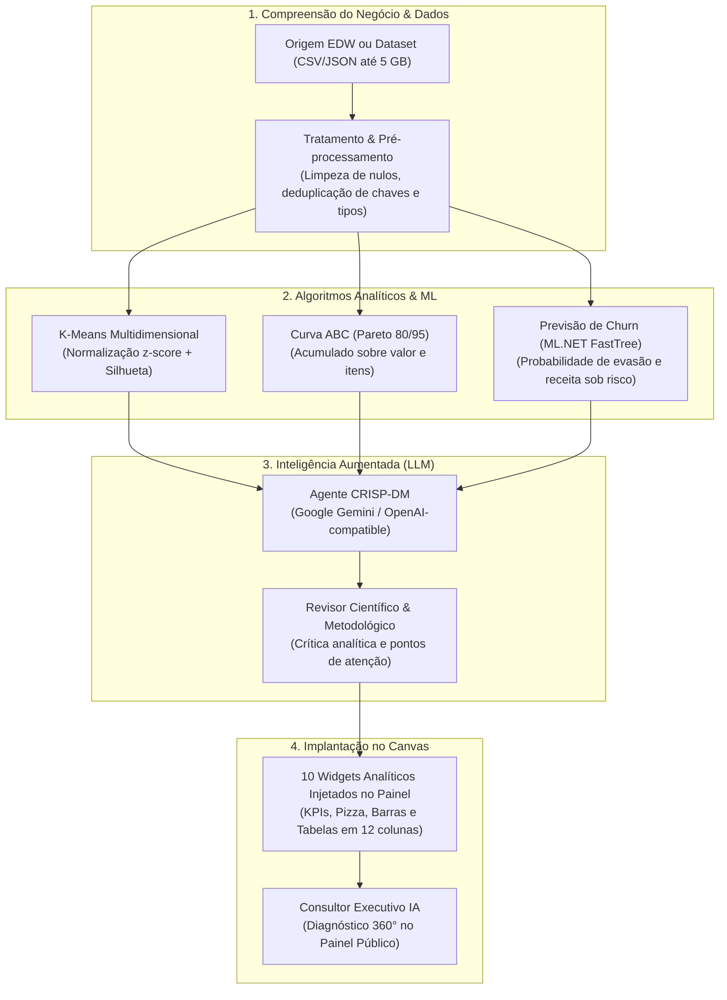

# Mineração de Dados & Inteligência Artificial — JT_BI

Este documento descreve o funcionamento do **Laboratório de Mineração de Dados (BI)** e do **Agente de IA (CRISP-DM)** do **JT_BI**, cobrindo o fluxo de dados reais (EDW ou Datasets importados de até 5 GB), os algoritmos de **Clusterização K-Means Multidimensional**, **Classificação Curva ABC (Pareto 80/95)**, **Previsão de Churn supervisionada com ML.NET (FastTree)**, integração com **LLMs (Google Gemini / OpenAI)** e a injeção de widgets no Canvas.

---

## 1. Visão Geral e Arquitetura CRISP-DM

O pipeline segue a metodologia **CRISP-DM** (*Cross-Industry Standard Process for Data Mining*):



---

## 2. Entrada de Dados e Pré-processamento

### 2.1. Fontes Suportadas
O Laboratório aceita tanto **tabelas reais do Enterprise Data Warehouse (EDW)** quanto **Datasets importados** (arquivos CSV ou JSON de até 5 GB).

| Fonte | Mecanismo de Leitura | Limite |
| :--- | :--- | :--- |
| **Origens EDW** (`Fato_{Tabela}`) | `DwConsultaService` via `/api/dw/amostra` (ou SQL direto local). | Até 50.000 registros na amostra do laboratório. |
| **Datasets Importados** (`dataset_{id}`) | `IBIDataSourceService.ObterLinhasDatasetAsync` a partir de `datasets.json`. | Suporta arquivos de até 5 GB com streaming assíncrono em chunks. |

### 2.2. Tratamento e Higienização de Dados
Antes de submeter os dados aos algoritmos matemáticos ou ao LLM, o método de tratamento sanitiza a fonte:
- **Deduplicação de chaves**: Agrupa ocorrências com o mesmo identificador (ex.: transações de vendas do mesmo `CustomerID`), somando valores monetários, calculando frequências e determinando a última data de compra (recência). Isso elimina colisões de dicionário (ex.: *"An item with the same key has already been added"*).
- **Conversão Numérica Bicultural**: `ExtrairDouble` suporta separadores decimais internacionais (`1234.56`) e no padrão brasileiro (`1.234,56`).
- **Tratamento de Nulos**: Linhas com identificador ou valores essenciais vazios são filtradas ou substituídas por valores padrão neutros.

---

## 3. Clusterização K-Means Multidimensional

Implementada em `BIDataMiningService.ExecutarKMeans`:

### 3.1. Normalização e Distância
- Suporta $N$ dimensões numéricas (ex.: Recência, Frequência, Monetário — RFM).
- Cada dimensão é normalizada via **z-score**:
  $$\tilde{x} = \frac{x - \mu}{\sigma}$$
  com $\sigma$ populacional. Quando $\sigma = 0$, adota-se $1$ para evitar divisão por zero.
- Aplicação de `log1p` para variáveis com cauda longa (ex.: receita monetária), garantindo que valores extremos não distorçam os centróides.

### 3.2. Parâmetros e Convergência
- Quantidade de clusters $k \in [2, 5]$ (configurável pelo usuário ou inferido pela IA).
- Inicialização determinística com semente fixa (`Random(42)`), permitindo reprodutibilidade dos resultados.
- Critério de parada: estabilidade dos centróides ou máximo de **50 iterações**.

### 3.3. Avaliação de Qualidade (Coeficiente de Silhueta)
O algoritmo calcula o **coeficiente de silhueta médio** ($s \in [-1, 1]$):
$$s(i) = \frac{b(i) - a(i)}{\max(a(i), b(i))}$$
onde $a(i)$ é a distância média intra-cluster e $b(i)$ é a menor distância média a outro cluster. O valor é exibido no subtítulo do widget KPI (ex.: *silhueta 0.42*).

### 3.4. Rotulagem dos Clusters
Os centróides são ordenados por volume financeiro e classificados semanticamente:
- $k=2$: `Alto Valor / VIP`, `Baixo Valor / Risco`
- $k=3$: `Alto Valor / VIP`, `Médio Potencial`, `Em Risco / Inativos`
- $k=4$: `VIP / Campeões`, `Alto Potencial`, `Atenção`, `Em Risco / Inativos`

---

## 4. Classificação Curva ABC (Princípio de Pareto 80/95)

Implementada em `BIDataMiningService.CalcularCurvaAbc`:

1. Agrupa e soma o valor acumulado por chave de identificação (produto, cliente ou categoria).
2. Ordena **decrescentemente** pelo valor monetário total.
3. Calcula o percentual acumulado sobre o faturamento global:
   $$\text{Acumulado}_i = \frac{\sum_{j=1}^{i} V_j}{V_{\text{total}}} \times 100$$
4. Enquadramento nas faixas:
   - **Classe A**: Responsáveis por até **80%** do faturamento total.
   - **Classe B**: Responsáveis pelos **15%** seguintes (de 80% a 95%).
   - **Classe C**: Responsáveis pelos **5%** restantes (de 95% a 100%).

O item que ultrapassa a linha divisória pertence à classe que ele completou. O resultado detalha o número de itens, valor total faturado e percentual de participação de cada classe.

---

## 5. Previsão de Churn com ML.NET (FastTree)

Implementada com **Microsoft.ML** e fallback estocástico em `BIDataMiningService.CalcularScoreRiscoChurn`:

### 5.1. Modelo Supervisionado (FastTree / Árvore de Decisão)
- **Features de Entrada**:
  - `RecenciaDias`: dias desde a última transação do cliente.
  - `Frequencia`: quantidade total de compras/pedidos no período.
  - `Monetario`: volume financeiro total transacionado.
- **Treinamento e Inferência**:
  - Utiliza `FastTreeBinaryTrainer` do ML.NET (`Microsoft.ML.FastTree`) para classificar a probabilidade de evasão do cliente ($0.0$ a $1.0$).
  - Clientes com probabilidade $> 0.70$ são classificados em **Alto Risco**, entre $0.40$ e $0.70$ em **Médio Risco**, e $< 0.40$ em **Baixo Risco**.

### 5.2. Métricas de Impacto Financeiro
- **Receita em Risco**: Soma do valor monetário de todos os clientes em `Alto Risco`.
- **Top 10 Clientes Prioritários para Retenção**: Tabela com os clientes de maior valor monetário sob risco de cancelamento, exibindo probabilidade e motivo principal (ex.: *Ausente há mais de 90 dias* ou *Queda abrupta de frequência*).

---

## 6. Agente de IA para Mineração e Provedores LLM

Implementado em `BIMineracaoAgenteService`:

### 6.1. Provedores Suportados
O agente suporta dois provedores principais com chave configurável na interface:
1. **Google Gemini** (Gemini 2.5 Flash / Pro): nativo via API do Google AI Studio.
2. **OpenAI-Compatible**: suporte a endpoints compatíveis (OpenAI GPT-4o, Ollama, LocalAI, vLLM).
3. **Fallback Heurístico Local**: Se a chave de API não estiver configurada ou a conexão falhar, o agente executa uma análise heurística determinística completa em C#, garantindo que a aplicação nunca pare de funcionar.

### 6.2. Ciclo de Análise do Agente
1. **Definição de Parâmetros com IA**: O LLM lê o objetivo do usuário (ex.: *"Segmentar clientes e prever churn"*) e sugere os melhores campos de valor, identificação e recência da fonte de dados.
2. **Executar Tudo com IA**: Dispara em paralelo o K-Means, Curva ABC e Churn FastTree, envia as estatísticas agregadas para o LLM e recebe uma síntese estratégica.
3. **Revisor Científico & Metodológico**: Uma segunda etapa de análise critica os resultados encontrados, avaliando o coeficiente de silhueta, concentração de receita da Curva ABC e eventuais vieses da base, gerando **Pontos de Atenção** práticos para a tomada de decisão executiva.

---

## 7. Geração e Injeção de Widgets no Canvas

Quando a análise é finalizada, **10 widgets analíticos** completos são injetados no painel ativo:

| # | Widget | Tipo | Largura no Grid | Propósito |
| :--- | :--- | :--- | :--- | :--- |
| 1 | **Segmentos K-Means** | `CardKpi` | 4 colunas (`col-lg-4`) | Quantidade de grupos, registros e silhueta. |
| 2 | **Distribuição dos Segmentos** | `GraficoPizza` | 8 colunas (`col-lg-8`) | Proporção de clientes por cluster K-Means. |
| 3 | **Valor Total por Segmento** | `GraficoBarras` | 6 colunas (`col-lg-6`) | Faturamento acumulado por perfil de grupo. |
| 4 | **Perfil Médio de cada Segmento** | `Tabela` | 6 colunas (`col-lg-6`) | Médias de recência, frequência e monetário. |
| 5 | **Quantidade de Itens por Classe** | `GraficoBarras` | 6 colunas (`col-lg-6`) | Distribuição das classes A, B e C da Curva ABC. |
| 6 | **Participação no Valor** | `GraficoPizza` | 6 colunas (`col-lg-6`) | Pareto do faturamento por classe ABC. |
| 7 | **Clientes em Alto Risco de Churn** | `CardKpi` | 4 colunas (`col-lg-4`) | Contagem e receita total em risco crítico. |
| 8 | **Distribuição de Risco de Churn** | `GraficoPizza` | 8 colunas (`col-lg-8`) | Proporção de clientes Alto, Médio e Baixo risco. |
| 9 | **Top 10 Clientes Prioritários** | `Tabela` | 12 colunas (`col-12`) | Clientes prioritários para ações de retenção. |
| 10 | **Parecer Executivo & Metodológico** | `Tabela` | 12 colunas (`col-12`) | Diagnóstico do LLM e revisor com planos de ação. |

Os widgets são vinculados com `FonteDadosId = "mineracao"` e possuem `DadosEstaticos` embutidos. As larguras obedecem à grade de 12 colunas Bootstrap (`LarguraColunas` 3, 4, 6, 8 e 12) sincronizada com `Largura` percentual, garantindo que o painel no Studio e a visualização compartilhada (`/compartilhado/{Token}`) exibam o layout organizado em pares e larguras totais.

---

## 8. Consultor Executivo IA no Painel Público

No visualizador compartilhado ([`VisualizadorPublico.razor`](file:///c:/Users/sirja/source/repos/mrjalves/JT_BI/Components/Pages/VisualizadorPublico.razor)), o componente [`BIPainelRelatorioIA.razor`](file:///c:/Users/sirja/source/repos/mrjalves/JT_BI/Components/BI/BIPainelRelatorioIA.razor) disponibiliza o painel executivo com três abas navegáveis:
- **Diagnóstico 360°**: Faturamento consolidado, ticket médio, principais classes ABC e síntese do consultor.
- **Segmentação & Pareto**: Métricas de concentração K-Means e Pareto de itens.
- **Previsão de Riscos & Churn**: Alertas de clientes e receita sob risco de evasão.

---

## 9. Suíte de Testes Automatizados

O projeto `tests/JT_BI.Tests` (NUnit) cobre toda a suíte com **54 testes automatizados**:
- Algoritmos K-Means (normalização, cálculo de silhueta, determinismo, limite de $k$).
- Curva ABC (limiares 80/95, ordenação decrescente, conversão cultural pt-BR).
- Previsão de Churn (FastTree ML.NET, categorização de risco, cálculo de receita exposta).
- Agente CRISP-DM e Revisor (estruturação de parecer, fallback determinístico, deduplicação de chaves).
- Geração de Widgets e Grade Bootstrap (sincronização `LarguraColunas` e `Largura`).

Comando para execução:
```bash
dotnet test tests/JT_BI.Tests/JT_BI.Tests.csproj
```
