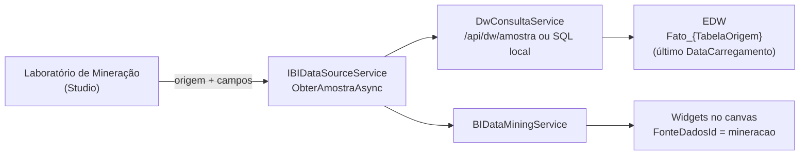

# Mineração de Dados — JT_BI

Este documento descreve como o laboratório de mineração do **JT_BI** obtém dados reais do EDW e como os algoritmos de **K-Means**, **Curva ABC** e **Score de Risco/Churn** são calculados.

A implementação é 100% C# (`BIDataMiningService`), sem runtime Python e sem dependência do notebook de referência em `Agentes/AGENTE_BI`.

---

## 1. Visão Geral



O modal **Laboratório de Mineração de Dados (BI)** é aberto pelo Studio. Ele lista apenas fontes com `OrigemId` (ou seja, origens reais do EDW); quando não há nenhuma origem configurada, exibe um aviso e a mineração não é executada.

---

## 2. Entrada de Dados

### 2.1. Seleção no modal

| Controle | Uso |
| :--- | :--- |
| **Origem de Dados (EDW)** | Define `origemMineracaoId`; as colunas da origem alimentam os `datalist` dos campos. |
| **Número de Clusters (K)** | UI oferece 2, 3 ou 4 grupos (o serviço aceita até 5). |
| **Campo de identificação** | Coluna usada como rótulo do item/cliente. |
| **Valor 1 / Valor 2** | Duas colunas numéricas do K-Means (ex.: valor e frequência). |
| **Campo de valor (ABC)** | Coluna numérica usada para ordenar e acumular a Curva ABC. |

### 2.2. Amostra

`BIDashboardPage.ObterRegistrosMineracaoAsync` chama:

```csharp
DataSourceService.ObterAmostraAsync(origemMineracaoId, colunas, 5000)
```

O caminho até o banco é:

1. `BIDataSourceService.ObterAmostraAsync` monta um `DwAmostraRequest`.
2. `DwConsultaService` usa `POST /api/dw/amostra` em modo API ou SQL parametrizado no modo local.
3. O SQL lê `Fato_{TabelaOrigem}` considerando apenas `DataCarregamento = MAX(DataCarregamento)`.
4. Os valores são convertidos para `Dictionary<string, string>` (case-insensitive).

A amostra é limitada a **5.000 linhas** no fluxo de mineração (`DwConsultaService` permite até 5.000 e no máximo 50 colunas).

---

## 3. K-Means

Implementação em `BIDataMiningService.ExecutarKMeans`.

### 3.1. Preparação

- Cada registro vira um `ClusterItem` com duas dimensões numéricas (`Valores`).
- Os valores originais são preservados em `ValoresOriginais` para relatórios.
- As dimensões são normalizadas por **z-score**:

$$\tilde{x} = \frac{x - \mu}{\sigma}$$

com $\sigma$ populacional. Se o desvio for zero (ou houver um único item), usa-se `1` para evitar divisão por zero. A normalização impede que colunas monetárias dominem a distância euclidiana.

### 3.2. Parâmetros

- `k` é limitado a `[2, 5]` e depois ao número de registros (com mínimo 1).
- As sementes são escolhidas por `Random(42)`, garantindo **resultado determinístico** entre execuções.
- O laço executa no máximo **50 iterações** ou até não haver mudança de cluster.
- A atribuição usa distância euclidiana ao quadrado (sem `sqrt`, pois a ordem é a mesma).

### 3.3. Saída

- `Grupos`: quantidade, percentual, cor, centróide (média dos valores **originais**) e nome.
- Os grupos são ordenados por média de `Valor 1` e renomeados:
  - `k = 2` → `Alto Valor / VIP`, `Baixo Valor / Risco`
  - `k = 3` → `Alto Valor / VIP`, `Médio Potencial`, `Baixo Valor / Risco`
  - `k = 4` → `Alto Valor / VIP`, `Médio-Alto`, `Médio-Baixo`, `Baixo Valor / Risco`
  - `k = 5` → `Cluster 1..5`
- `ResumoExecutivo` informa iterações, clusters e total de registros.

---

## 4. Curva ABC

Implementação em `BIDataMiningService.CalcularCurvaAbc`.

1. Lê `Campo nome` e `Campo valor` de cada registro.
2. Ordena **decrescente** por valor.
3. Acumula o valor e calcula o percentual acumulado:

$$\text{acumulado} = \frac{\sum_{i=1}^{n} v_i}{\text{total}} \times 100$$

4. Classifica usando o acumulado **anterior** ao item:

| Acumulado anterior | Classe |
| :--- | :--- |
| `< 80%` | A |
| `>= 80%` e `< 95%` | B |
| `>= 95%` | C |

Assim, **o item que cruza a faixa pertence à classe que ele completou**. Exemplo com valores `70`, `20`, `10`:

| Item | Acumulado | Classe |
| :--- | :--- | :--- |
| 70 | 70% | A |
| 20 | 90% | A |
| 10 | 100% | B |

O resultado inclui `QtdClasseA/B/C` e `TotalGeral`.

### 4.1. Conversão numérica

`ExtrairDouble` tenta `InvariantCulture` e, em seguida, `pt-BR`. Isso permite ler tanto `1234.56` quanto `1.234,56`.

---

## 5. Score de Risco / Churn

Implementação em `BIDataMiningService.CalcularScoreRiscoChurn`.

```
scoreDias = min(60, diasSemComprar * 0.8)
scoreCanc = min(40, qtdCancelamentos * 20)
score     = min(100, max(0, scoreDias + scoreCanc))
```

| Score | Categoria |
| :--- | :--- |
| `>= 70` | Crítico |
| `>= 40` | Médio |
| `< 40` | Baixo |

O motivo prioriza dias sem atividade quando `dias > 60`; caso contrário, destaca cancelamentos; se nenhum critério se aplica, usa `Engajamento regular`. A saída é ordenada por score decrescente.

> O laboratório do Studio executa atualmente K-Means e Curva ABC. O cálculo de churn está disponível no serviço (`CalcularScoreRiscoChurn`) para uso por novas telas e pelo consultor.

---

## 6. Geração de Widgets

| Método | Widgets gerados |
| :--- | :--- |
| `GerarWidgetsMinacao` | KPI com número de clusters, gráfico de pizza com distribuição e tabela detalhada. |
| `GerarWidgetsCurvaAbc` | KPI de itens Classe A e gráfico de barras A/B/C. |

Todos os widgets recebem:

- `FonteDadosId = "mineracao"`
- `DadosEstaticos` com os pontos calculados (rótulo, valor, percentual, cor e valor formatado)

`BIDataSourceService` reconhece a fonte `mineracao` e devolve `DadosEstaticos` diretamente, sem nova consulta ao EDW. Os widgets são persistidos no dashboard; os dados de origem **não** são armazenados.

---

## 7. Limites e Tratamento de Erros

| Situação | Comportamento |
| :--- | :--- |
| Nenhuma origem EDW | Modal exibe aviso; nenhuma mineração é executada. |
| Campos não informados | Feedback de aviso e retorno vazio. |
| Amostra vazia | Feedback de aviso; nenhum widget é gerado. |
| Menos de 2 registros no K-Means | Execução abortada. |
| Curva ABC sem registros | Resultado vazio, sem widgets. |
| Falha de comunicação/SQL | `DwConsultaResultado.Sucesso = false` com `Mensagem`; a UI não injeta widgets. |

---

## 8. Testes Automatizados

O projeto `tests/JT_BI.Tests` (NUnit) cobre os algoritmos com **15 testes**:

- K-Means: normalização z-score, preservação dos valores originais, ordenação dos clusters, determinismo, limite de `k` e caso de um único registro.
- Curva ABC: limite 80/95, ordenação decrescente, interpretação `pt-BR` e entrada vazia.
- Churn: faixas de score, motivos e ordenação.
- Widgets: fonte `mineracao`, dados estáticos e percentuais.

Execução:

```bash
dotnet test tests/JT_BI.Tests/JT_BI.Tests.csproj
```

A pasta `tests/` é excluída do build e do publish do host `JT_BI.csproj`.

---

## 9. Limitações e Evolução

- K-Means bidimensional: não há seleção automática de `k` (cotovelo/silhueta) nem mais de duas dimensões na UI.
- RFM completo ainda não é calculado; a base atual usa duas métricas escolhidas pelo usuário.
- O score de churn não está exposto no modal do Studio.
- O determinismo depende da ordem dos registros retornada pela amostra; para séries grandes, considere `ORDER BY` estável.
